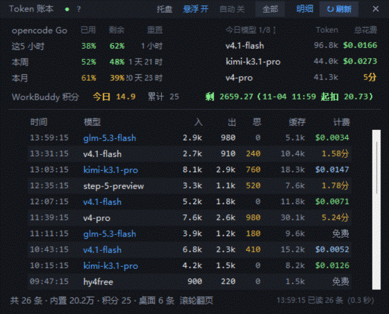
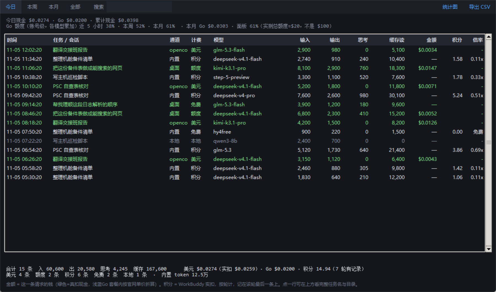
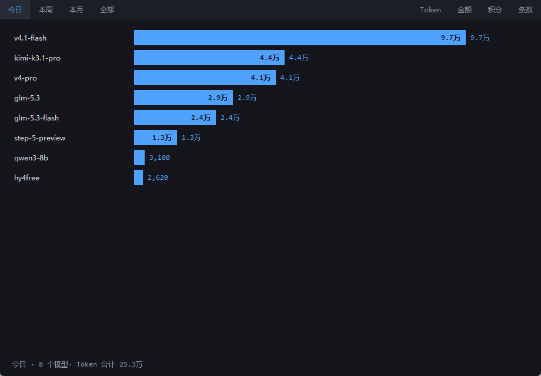

**English** | [简体中文](README.zh-CN.md)

[](https://github.com/ww330115/token-ledger/actions/workflows/check.yml)

# Token Ledger

A tiny Windows desktop widget that turns your local AI client usage — **WorkBuddy** and **opencode desktop** — into a live ledger of tokens, quota, credits, and cash.

- **Read-only.** It reads local log files. No login, no upload, no proxy interception.
- **Five billing channels, never mixed:** local / USD / quota / free / credits.
- **One Python file, zero third-party dependencies.**
- **Docs for humans and agents:** `README.md` for you, [`SKILL.md`](SKILL.md) for your agent.



> Every session, amount, and quota number in these screenshots comes from `--demo` fake data. None of it is the author's real usage.

## What it answers

| Question | Where |
|---|---|
| How much cash did I spend today? How much Go quota did I use? | First line of the header |
| How much opencode Go quota is left (5-hour / weekly / monthly)? | Three meters in the account area |
| How many WorkBuddy credits were used today, and how many are left? | Second line |
| Which model burned the most tokens today? | "Today's models" list on the right |
| What exactly was each request — task, model, tokens? | The **Details** window |

## Screenshots

| Details | Model stats |
|---|---|
|  |  |

## Quick start (Windows)

### Option 1: portable package (no Python required)

1. Download `token-ledger-portable-win64.zip` from [Releases](../../releases).
2. Unzip it anywhere (avoid `&` and `%` in the path).
3. Double-click `run.bat`.

The package bundles its own Python runtime. Config and logs live in `data\` next to the executable, so deleting the folder is a clean uninstall.

### Option 2: run from source

Requires Python 3.10+ (the official Windows installer includes tkinter):

```powershell
git clone https://github.com/ww330115/token-ledger.git
cd token-ledger
pythonw token_ledger.py
```

Or just double-click `run.bat`.

Check whether it can see your data (no window):

```powershell
python token_ledger.py --check
```

Want to see the UI without any local client installed:

```powershell
python token_ledger.py --demo
```

## Where the data comes from

Everything is **read-only**. All four paths can be overridden in `config.json` or on the command line.

| Source | Default path | Used for | If missing |
|---|---|---|---|
| WorkBuddy logs | `~/.workbuddy/projects/**/*.jsonl` | Per-request tokens, credits, gateway billing | No data for the built-in / gateway lanes |
| WorkBuddy DB | `~/.workbuddy/workbuddy.db` | Credits actually charged, session titles | Credits fall back to the self-reported value in logs; task names fall back to folder names |
| opencode DB | `~/.local/share/opencode/opencode.db` | Per-message tokens and cost from the desktop app | No data for the desktop lane |
| opencode service | `~/.local/state/opencode/service.json` | Real Go quota from the local service | Quota meters show `—`; everything else still works |

`~` is your home directory (`C:\Users\<you>`). If opencode is installed elsewhere, point `opencode.db` and `service.json` at it.

## The five billing channels

This is the point of the tool: **"money" means different things on different channels, and they must never be added together.**

| Channel | Meaning | Source |
|---|---|---|
| Local | Local/offline model, not billed | `requestModelId` starts with `custom-local:` |
| USD | Gateway-returned `list_cost`, real money | `rawUsage.opencode.list_cost` in logs |
| Quota | opencode Go usage, not billed per token | Desktop `providerID` starts with `opencode-go` |
| Free | Free model, or a zero-cost request | `-free` models / zero-cost gateway requests |
| Credits | WorkBuddy built-in models, charged in credits | `credit_json` in the DB, falling back to `rawUsage.credit` |

The credit price is not public, so the tool **shows credits, never converts them to money**.
Go amounts are the "quota value" computed from official model prices; they do not charge your card.

## CLI

```text
python token_ledger.py [options]

  --check                 Print stats, no window
  --json                  With --check, emit machine-readable JSON (for agents)
  --demo                  Preview the UI with fake data; reads no local files
  --data-dir DIR          Where config and logs live (default %APPDATA%\TokenLedger)
  --config FILE           Use a specific config file
  --projects DIR          WorkBuddy log directory
  --workbuddy-db FILE     WorkBuddy workbuddy.db
  --opencode-db FILE      opencode opencode.db
  --service-json FILE     opencode service.json
  --detail                Open the details window on start
  --stats                 Open the model stats window on start
  --only-oc               Show only the opencode lane
  --version               Print version
```

Examples:

```powershell
python token_ledger.py --check
python token_ledger.py --check --json
python token_ledger.py --check --projects "D:\backup\.workbuddy\projects"
```

`--check --json` returns (excerpt):

```json
{
  "version": "1.0.0",
  "demo": false,
  "records": 15366,
  "lanes": {
    "内置": { "records": 12071, "input": 53647060, "output": 10831855,
              "thinking": 4580755, "cache_read": 1508192188, "usd": 0.0 }
  },
  "today": { "usd": 0.0, "allowance": 0.0, "credits": 12.5, "credit_turns": 9 },
  "totals": { "records": 15366, "usd": 2.7099, "credits": 2763.79,
              "credit_turns": 856, "titles": 135, "tasks_today": 4 },
  "billing": { "美元": 995, "额度": 911, "积分": 8522, "免费": 4892, "本地": 46 }
}
```

`billing` keys and lane names stay in Chinese because they are displayed in the UI.

## Configuration

On first run a config file is created at `%APPDATA%\TokenLedger\config.json`:

```json
{
  "wb_projects": "~/.workbuddy/projects",
  "wb_db": "~/.workbuddy/workbuddy.db",
  "oc_db": "~/.local/share/opencode/opencode.db",
  "oc_service": "~/.local/state/opencode/service.json",
  "pin": true,
  "auto": false,
  "win_pos": [1600, 900],
  "credit_left": 2680.0,
  "credit_left_at": 1793791796
}
```

- `pin` — keep the window on top
- `auto` — rescan every 2 seconds (off by default; manual refresh is lighter)
- `win_pos` — window position, saved when you drag it
- `credit_left` / `credit_left_at` — your manually entered credit balance and timestamp; the UI subtracts credits spent since then

**Change the data directory:**

- `TOKEN_LEDGER_HOME=D:\my-data`
- `--data-dir D:\my-data`
- Portable mode: drop an empty `portable.txt` next to `token_ledger.py`; data goes to `data\`

Config, `logs\error.log`, `logs\额度观测.csv`, and exported CSVs all live there — **nothing is written to the code directory**.

## FAQ

**`--check` reads 0 records?**
It prints the actual path and existence of all four sources. Point them at the right place:

```powershell
python token_ledger.py --check --projects "D:\your\.workbuddy\projects"
```

**The opencode quota always shows `—`?**
The opencode desktop app must be running; it writes the local service address and password to `service.json`. The tool only talks to `127.0.0.1` and bypasses proxies.

**How do I set the credit balance?**
Click "剩 未填（点这里）" in the UI and enter the current official balance. From then on it shows "baseline − credits spent since".

**Numbers differ from the official dashboard?**
- USD/quota come from logs and the local service; official price changes may lag
- Credits come from `credit_json`
- The official site may aggregate differently or update late

**macOS / Linux?**
It imports and `--check` runs, but the tray, multi-monitor placement, and edge-docking are Win32-only and disable themselves elsewhere. The UI is tkinter and should be portable, but it is untested.

**Does it upload my usage?**
No. The only network request goes to `127.0.0.1` (the opencode service) to read quota. No telemetry, no auto-update.

## Privacy

- All data comes from local log files and never leaves the machine
- The only request: `http://127.0.0.1:<port>/api/experimental/usage/limits`
- Exported CSVs stay in your data directory
- Screenshots in this repo use `--demo` fake data

## For agents

[`SKILL.md`](SKILL.md) documents how an agent should call this tool and how to read the JSON.

```powershell
python token_ledger.py --check --json
```

Read `today` / `totals` / `billing` from the JSON. No need to parse the Chinese text output, no window.

## Development

- Single file, ~3,000 lines, zero third-party dependencies
- Before committing: `--check`, `--check --json`, `--demo`
- Build the portable package: `powershell -ExecutionPolicy Bypass -File build_portable.ps1`

## Disclaimer

Unofficial tool. Not affiliated with WorkBuddy or opencode. Prices, quota, and credits are
authoritative only on their official dashboards; this tool merely records and displays local data.

## License

[MIT](LICENSE) © 2026 Token Ledger contributors
