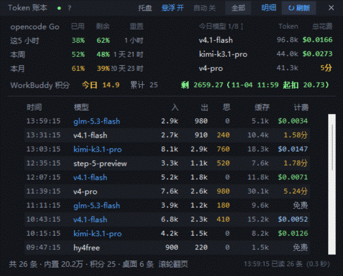
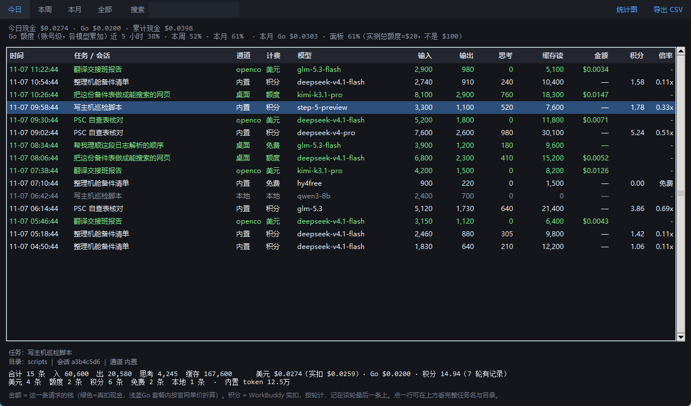
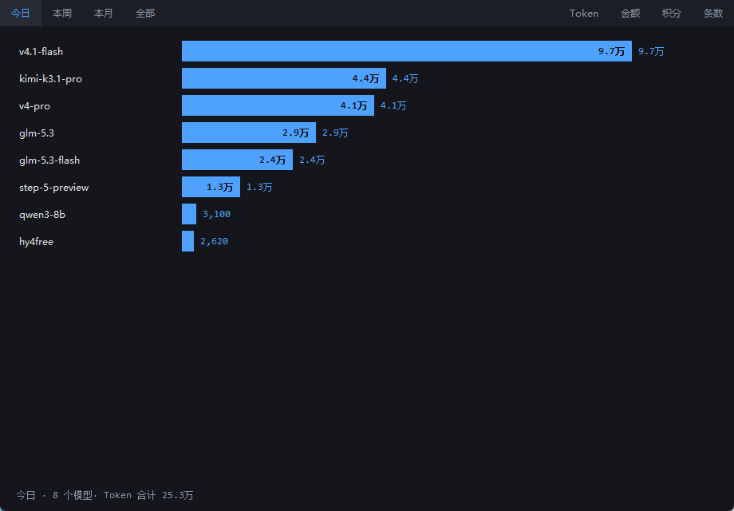

**English** | [简体中文](README.zh-CN.md)

[](https://github.com/ww330115/token-ledger/actions/workflows/check.yml)

# Token 账本 · Token Ledger

一个 Windows 桌面小工具：把本机 AI 客户端（WorkBuddy、opencode 桌面版）每次请求的 **token、额度、积分、现金** 记成一本实时账，悬浮窗常驻桌面，随时看今天花了多少。

- **只读本地日志**，不登录、不上传、不抓包
- **五种计费口径分开记**，绝不混算：本地 / 美元 / 额度 / 免费 / 积分
- 单一 Python 文件，**零第三方依赖**（只用标准库）
- 有给人和给 agent 的两套说明：`README.md`（人）+ `SKILL.md`（agent）



> 截图里的会话、金额、额度全部是 `--demo` 生成的假数据，和作者的真实使用无关。

## 它能回答什么

| 问题 | 界面位置 |
|---|---|
| 今天花了多少现金？Go 套餐用掉多少？ | 顶部第一行 |
| opencode Go 的近 5 小时 / 本周 / 本月额度还剩多少？ | 账户区三个进度条 |
| WorkBuddy 积分今天扣了多少、累计多少、余额还剩多少？ | 第二行积分区 |
| 每个模型今天用了多少 token、走的是哪条通道？ | 右侧“今日模型”榜（每个通道一行） |
| 每一条请求具体是什么任务、什么模型、多少 token？ | 【明细】窗口 |

## 截图

| 明细表 | 模型统计 |
|---|---|
|  |  |

## 快速开始（Windows）

### 方式一：便携包（不装 Python）

1. 到 [Releases](../../releases) 下载 `token-ledger-portable-win64.zip`
2. 解压到任意目录（路径别含 `&`、`%` 这类字符）
3. 双击 `run.bat`

便携包自带 Python 运行时，配置和日志写在解压目录的 `data\` 里，删掉整个文件夹就干净卸载。

### 方式二：源码运行

需要 Python 3.10+（Windows 官方安装包自带 tkinter）：

```powershell
git clone https://github.com/ww330115/token-ledger.git
cd token-ledger
pythonw token_ledger.py
```

或者直接双击仓库里的 `run.bat`。

先看看能不能读到数据（不开窗口）：

```powershell
python token_ledger.py --check
```

想先看界面长什么样、但本机没有这些客户端：

```powershell
python token_ledger.py --demo
```

## 数据从哪来

全部是**只读**。路径都能在 `config.json` 里改，也能用命令行参数临时指定。

| 数据源 | 默认路径 | 用途 | 没有会怎样 |
|---|---|---|---|
| WorkBuddy 日志 | `~/.workbuddy/projects/**/*.jsonl` | 每轮请求的 token、积分、网关账单 | 内置/网关两条通道没有数据 |
| WorkBuddy 台账 | `~/.workbuddy/workbuddy.db` | 每轮实际扣的积分、会话标题 | 积分按日志自报值算，任务名退化成目录名 |
| opencode 会话库 | `~/.local/share/opencode/opencode.db` | 桌面版每条消息的 token 与 cost | 桌面通道没有数据 |
| opencode 服务 | `~/.local/state/opencode/service.json` | 向本机服务要 Go 套餐真实额度 | 额度条显示 `—`，其余照常 |

`~` 指当前用户目录（`C:\Users\你的名字`）。opencode 桌面版如果装在别处，把它自己的
`opencode.db` 和 `service.json` 路径填进配置即可。

## 五种计费口径

这是本工具最在意的一点：**不同通道的“钱”不是同一种东西，不能相加**。

| 口径 | 含义 | 数据来源 |
|---|---|---|
| 本地 | 本机/离线模型，不计费 | `requestModelId` 以 `custom-local:` 开头 |
| 美元 | 网关回传的 `list_cost`，真金白银 | 日志里的 `rawUsage.opencode.list_cost` |
| 额度 | opencode Go 套餐内消耗，不按 token 收现金 | 桌面版 `providerID` 以 `opencode-go` 开头 |
| 免费 | 免费模型，或套餐外但本轮 cost 为 0 | `-free` 模型 / 网关 0 元请求 |
| 积分 | WorkBuddy 内置模型实扣积分 | 台账 `credit_json`，缺失时用日志 `rawUsage.credit` |

积分单价官方没公开，所以本工具**只显示积分，不把积分折成人民币或美元**。
Go 套餐的金额是按官方模型目录单价折算的“额度价值”，不额外扣现金。

模型榜也遵守这条规则：按 **“通道 + 模型”** 分行。同一个模型名可能同时出现在内置通道（积分）
和 Go 通道（额度价值）里，显示成两行，各自记各自的钱，不能相加。

## 命令行

```text
python token_ledger.py [选项]

  --check                 只打印统计，不开窗口
  --json                  配合 --check 输出机器可读 JSON（给 agent 用）
  --demo                  假数据预览界面，不读本机任何文件
  --data-dir DIR          配置和日志放哪（默认 %APPDATA%\TokenLedger）
  --config FILE           指定配置文件
  --projects DIR          WorkBuddy 日志目录
  --workbuddy-db FILE     WorkBuddy 台账 workbuddy.db
  --opencode-db FILE      opencode 会话库 opencode.db
  --service-json FILE     opencode 服务地址文件 service.json
  --detail                启动时直接打开明细表
  --stats                 启动时直接打开模型统计图
  --only-oc               悬浮窗只显示 opencode 通道
  --version               版本号
```

示例：

```powershell
# 自检 + 中文摘要
python token_ledger.py --check

# 给脚本/agent 的 JSON
python token_ledger.py --check --json

# 日志在别处
python token_ledger.py --check --projects "D:\backup\.workbuddy\projects"
```

`--check --json` 输出结构（节选）：

```json
{
  "version": "1.0.0",
  "demo": false,
  "records": 15366,
  "lanes": {
    "内置": { "records": 12071, "input": 53647060, "output": 10831855,
              "thinking": 4580755, "cache_read": 1508192188, "usd": 0.0 }
  },
  "today": { "usd": 0.0, "allowance": 0.0, "credits": 12.5, "credit_turns": 9 },
  "totals": { "records": 15366, "usd": 2.7099, "credits": 2763.79,
              "credit_turns": 856, "titles": 135, "tasks_today": 4 },
  "billing": { "美元": 995, "额度": 911, "积分": 8522, "免费": 4892, "本地": 46 }
}
```

## 配置

首次运行会在 `%APPDATA%\TokenLedger\config.json` 生成配置。可以手动改，键名与命令行参数对应：

```json
{
  "wb_projects": "~/.workbuddy/projects",
  "wb_db": "~/.workbuddy/workbuddy.db",
  "oc_db": "~/.local/share/opencode/opencode.db",
  "oc_service": "~/.local/state/opencode/service.json",
  "pin": true,
  "auto": false,
  "win_pos": [1600, 900],
  "credit_left": 2680.0,
  "credit_left_at": 1793791796
}
```

- `pin`：窗口是否置顶
- `auto`：是否每 2 秒自动扫描（默认手动，更省电）
- `win_pos`：窗口位置，拖动后自动保存
- `credit_left` / `credit_left_at`：你手动填的积分余额基准和时间；界面会在此基础上减去之后实扣的积分

**数据目录可以换**：

- 环境变量 `TOKEN_LEDGER_HOME=D:\my-data`
- 命令行 `--data-dir D:\my-data`
- 便携模式：在 `token_ledger.py` 旁边放一个空文件 `portable.txt`，数据就写到 `data\`

配置、错误日志（`logs\error.log`）、额度观测（`logs\额度观测.csv`）、导出 CSV（`exports\`）都在这个目录里，**不会写进代码目录**。

## 常见问题

**读完 0 条怎么办？**
`--check` 会打印四个数据源的实际路径和是否存在。把路径填对即可：

```powershell
python token_ledger.py --check --projects "D:\你的\.workbuddy\projects"
```

**opencode 额度一直显示 `—`？**
需要 opencode 桌面版正在运行（它会把本地服务地址和口令写进 `service.json`）。本工具只访问 `127.0.0.1`，不经过代理。

**积分余额怎么填？**
点界面上的“剩 未填（点这里）”，输入当前官方余额。之后显示的是“基准 − 基准之后的实扣”，不会凭空估算。

**为什么同一个模型在榜单里出现两次？**
因为它可以走不同的计费通道。比如 `deepseek-v4.1-flash` 既能在 WorkBuddy 内置通道用（扣积分），
也能通过 opencode Go 用（扣套餐额度）。模型榜按 **“通道 + 模型”** 分行，两行各显示自己的金额。
积分和额度价值是两种东西，不能相加。

**opencode 重启后额度显示“接口不通”？**
opencode 重启会重写 `service.json`（换端口和口令）。如果账本正好在这个窗口里取额度，请求就会失败。
它每 60 秒重试一次，会自己恢复；想立刻恢复就点一下 **刷新**。

**数字和官方后台对不上？**
- 美元/额度以日志和本机服务返回为准，官方改价后可能滞后
- 积分以台账 `credit_json` 为准
- 官方页面可能有延迟或不同的统计口径

**支持 macOS / Linux 吗？**
代码能 import、`--check` 能跑，但托盘、多屏定位、贴边收起是 Win32 实现，非 Windows 上会自动关闭。界面本身是 tkinter，理论上可移植，但未实测。

**会不会把我用了多少 token 传出去？**
不会。唯一的网络请求是发往本机 `127.0.0.1` 的 opencode 服务，用于取额度。没有任何遥测、统计、自动更新。

**为什么叫“账本”而不是“监控”？**
它只读日志文件，不注入、不代理、不拦截请求，也不改任何客户端的数据。

## 隐私

- 所有数据来自你本机的日志文件，**不出本机**
- 唯一的网络请求：`http://127.0.0.1:<端口>/api/experimental/usage/limits`
- 导出的 CSV 只写在你选定的数据目录
- 仓库里的截图使用 `--demo` 假数据，不含任何真实会话

## 给 agent 用

仓库里的 [`SKILL.md`](SKILL.md) 是给 AI agent 的说明：怎么调用、参数是什么、JSON 怎么解析。
最简单的接入方式：

```powershell
python token_ledger.py --check --json
```

agent 读 JSON 里的 `today` / `totals` / `billing` 即可，不需要解析中文输出，也不需要开窗口。

## 开发

- 单文件，约 3000 行，零第三方依赖
- 改动后至少跑一遍：`python token_ledger.py --check`、`--check --json`、`--demo`
- 打便携包：`powershell -ExecutionPolicy Bypass -File build_portable.ps1`

## 免责声明

非官方工具，与 WorkBuddy、opencode 官方无任何关系。价格、额度、积分以官方为准；
本工具只做本地记录与展示，不对账目差异负责。

## License

[MIT](LICENSE) © 2026 Token Ledger contributors
